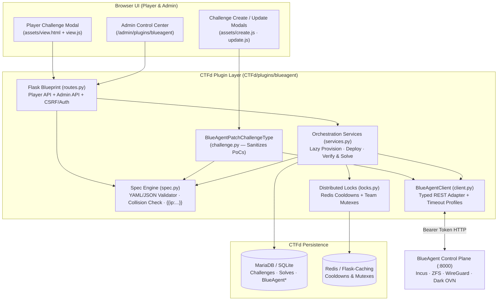

# BlueCTFd — Web Platform & BlueAgent Plugin Architecture

[](https://github.com/CTFd/CTFd)
[](CTFd/plugins/blueagent/)
[](https://www.python.org/)

This directory contains **BlueCTFd**, the competition web frontend and scoring platform for the BlueCTFd cyber range. It builds on upstream [**CTFd**](https://github.com/CTFd/CTFd) (Apache-2.0) and embeds the first-party **`blueagent` plugin** ([`CTFd/plugins/blueagent/`](CTFd/plugins/blueagent/)) to orchestrate live Patch-and-Defense challenges against a bare-metal [**BlueAgent**](../blueagent/README.md) control plane.

> For full host bootstrap and hybrid Docker / bare-metal startup instructions, see the [Root Monorepo README](../README.md). To contribute to the platform or plugin, read [`CONTRIBUTING.md`](CONTRIBUTING.md).

---

## Table of Contents

1. [Plugin Architecture & Integration Overview](#1-plugin-architecture--integration-overview)
2. [Database Schema & Domain Models](#2-database-schema--domain-models)
3. [End-to-End Player & Verification Flows](#3-end-to-end-player--verification-flows)
4. [Plugin Source Layout](#4-plugin-source-layout)
5. [Plugin HTTP Endpoints Reference](#5-plugin-http-endpoints-reference)
6. [Configuration & Precedence Hierarchy](#6-configuration--precedence-hierarchy)
7. [Developer Setup (Docker & Native) & Testing](#7-developer-setup-docker--native--testing)

---

## 1. Plugin Architecture & Integration Overview

Standard CTFd challenges validate static flags submitted via text input. The **`blueagent` plugin** registers a polymorphic challenge type (**`blueagent_patch`**) that transforms CTFd into an interactive cyber-defense controller:



### Core Design Mechanisms

1. **Exploit Payload Sanitization (`challenge.py`)**:
   Challenge authors define `readiness_commands` and `verify_commands` (including real PoC exploit invocations) inside a single declarative YAML/JSON specification. When `BlueAgentPatchChallengeType.read()` serializes a challenge for players, it **strips `verify_commands` and raw `spec_json`**, exposing only container hostnames, static target IPs (`10.k.1.<ip_suffix>`), cooldown timers, and deployment state.
2. **Deterministic `team_k` Subnet Allocation (`models.py`)**:
   `BlueAgentTeamMapping.get_or_create()` maps each CTFd Team (or User in Users Mode) to a unique integer `team_k ∈ [1..254]` (`0` is reserved for host infrastructure) using SQLAlchemy nested transaction savepoints (`db.session.begin_nested()`) to handle concurrent team registrations without race collisions:
   - Team WireGuard subnet: `10.<team_k>.0.0/24` (Gateway `.1`, Peers `.2..254`)
   - Team Container subnet: `10.<team_k>.1.0/24` (Bridge `br-team-<k>` `.1`, Services `.2..254`, Ephemeral Verifier `.250`)
3. **Global Container & IP Collision Prevention (`spec.py`)**:
   Because all challenges deployed for a team coexist on the same `br-team-k` Layer-2 broadcast domain (`10.k.1.0/24`), `check_global_collisions()` validates on challenge creation/update that every container `name` and `ip_suffix` is globally unique across all stored `blueagent_patch` challenges.
4. **Redis Cooldowns with Infrastructure Failure Refunds (`locks.py` & `services.py`)**:
   Before calling BlueAgent's `/verificator`, the plugin acquires a short-lived Redis team mutex and sets a per-team verification cooldown (`verify_cooldown`, default `30s`). If BlueAgent responds with `HTTP 409 Conflict` (verification already running) or `5xx`/network timeout, `services.py` **automatically clears/refunds the cooldown** so players are never penalized for orchestrator contention or transient infrastructure faults.
5. **Atomic Solve Recording**:
   When BlueAgent returns `success == True` and `passed == True`, `services.py` atomically inserts a CTFd `Solves` record (checking duplicates inside the DB transaction), clears CTFd's standings cache, and immediately updates the scoreboard. Static text-flag submissions on `blueagent_patch` challenges are rejected unless `allow_flag_fallback=True` is explicitly enabled on the challenge.

---

## 2. Database Schema & Domain Models

Defined in [`CTFd/plugins/blueagent/models.py`](CTFd/plugins/blueagent/models.py) and auto-created during plugin `load(app)`:

| Table Name | Model Class | Key Columns & Responsibility |
| :--- | :--- | :--- |
| `blueagent_challenges` | `BlueAgentPatchChallenge` | Polymorphic child of `challenges` (`type='blueagent_patch'`). Stores `spec_yaml`, normalized `spec_json`, `auto_deploy`, `show_verify_details`, `verify_cooldown`, `allow_flag_fallback`, and indexed `container_names` / `ip_suffixes` JSON arrays. |
| `blueagent_team_mappings` | `BlueAgentTeamMapping` | Maps `(account_id, account_type)` uniquely to `team_k` (`1..254`) and tracks `provisioned` state on BlueAgent. |
| `blueagent_deployments` | `BlueAgentDeployment` | Unique on `(team_k, challenge_id)`. Tracks container lifecycle state (`idle`, `deploying`, `running`, `failed`, `torn_down`) and `last_error`. |
| `blueagent_verify_logs` | `BlueAgentVerifyLog` | Immutable audit trail of every verification run (`team_k`, `challenge_id`, `user_id`, `passed`, `success`, `message`, `details_json`, `duration_ms`, `created_at`). |

---

## 3. End-to-End Player & Verification Flows

1. **Lazy Provisioning & VPN Download (`GET /api/v1/plugins/blueagent/vpn/download`)**:
   - Allocates `team_k` if the team has none → calls `PUT /teams/{team_k}` on BlueAgent → calls `PUT /teams/{team_k}/members/{user_id}` → streams `team<k>-user<id>.conf` (`application/x-wireguard-profile`) to the player's browser.
2. **Instance Deployment (`POST /api/v1/plugins/blueagent/challenges/<id>/start`)**:
   - Ensures team network exists → renders `{{team_k}}`, `{{subnet}}`, `{{verifier_ip}}`, and `{{ip:<name>}}` placeholders → calls `POST /teams/{team_k}/machines` → marks `BlueAgentDeployment.status = "running"` and returns resolved target IPs (`10.k.1.x`). (Also triggered automatically when a player opens the modal if `auto_deploy=True`.)
3. **Patch Verification (`POST /api/v1/plugins/blueagent/challenges/<id>/verify`)**:
   - Checks existing solve → checks/sets Redis cooldown & team lock → sends full rendered `ChallengeConfig` (including secret `verify_commands`) to `POST /teams/{team_k}/verificator` → records `BlueAgentVerifyLog` → awards `Solves` if `passed == True` → strips `details` from player JSON unless `show_verify_details=True`.

---

## 4. Plugin Source Layout

```text
CTFd/CTFd/plugins/blueagent/
├── __init__.py                  # CTFd plugin entrypoint: load(app), DB table creation, Admin menu registration
├── config.py                    # Settings resolver (CTFd DB config > Env Vars > Defaults)
├── models.py                    # SQLAlchemy models (Challenge, TeamMapping, Deployment, VerifyLog)
├── spec.py                      # YAML/JSON parser, schema validator, collision detector, {{...}} renderer
├── client.py                    # Requests-based BlueAgent REST client + custom exception hierarchy
├── locks.py                     # Redis/Flask-Caching team mutexes and atomic verification cooldowns
├── services.py                  # Core domain workflows (provision, deploy, teardown, verify & solve)
├── challenge.py                 # BlueAgentPatchChallengeType (CRUD hooks + player read() sanitization)
├── routes.py                    # Flask Blueprint for player (/api/v1/...) & admin (/admin/...) endpoints
├── assets/
│   ├── blueagent.css            # UI styles for player modal badges, VPN card, and Admin Control Center
│   ├── create.html / create.js  # Admin challenge creation form with live YAML/JSON spec validation
│   ├── update.html / update.js  # Admin challenge editor
│   ├── view.html / view.js      # Player challenge modal (VPN download, peer telemetry, targets, verify)
│   └── admin.js                 # 5-tab Admin Control Center SPA controller
├── templates/blueagent/
│   └── admin_dashboard.html     # Jinja2 Admin Control Center template extending admin/base.html
└── tests/
    ├── conftest.py              # Isolated CTFd Flask app factory & mocked BlueAgent fixtures
    ├── test_spec.py             # YAML/JSON validation, collisions, and placeholder rendering tests
    ├── test_client.py           # HTTP error mapping & auth header unit tests
    ├── test_mapping.py          # Deterministic team_k allocation & 254-slot exhaustion tests
    ├── test_verify_flow.py      # Solve recording, duplicate protection, and cooldown refund tests
    ├── test_routes_admin.py     # RBAC authorization & admin/player route contract tests
    └── test_use_cases.py        # Multi-step competition workflow & edge-case tests
```

---

## 5. Plugin HTTP Endpoints Reference

### Player Endpoints (Require Authenticated User / Team)

| Method | Path | Description |
| :---: | :--- | :--- |
| `GET` | `/api/v1/plugins/blueagent/status` | Returns team `team_k`, deployment state for `?challenge_id=<id>`, resolved container target IPs, and remaining cooldown seconds. Triggers lazy auto-deploy if `auto_deploy=True`. |
| `POST` | `/api/v1/plugins/blueagent/challenges/<id>/start` | Deploys or restarts the team's containers for challenge `<id>`. |
| `GET` | `/api/v1/plugins/blueagent/vpn/download` | Lazily provisions team + member on BlueAgent and downloads the user's WireGuard `.conf`. |
| `GET` | `/api/v1/plugins/blueagent/vpn/status` | Returns the current user's live WireGuard peer status (online, latest handshake, Rx/Tx bytes). |
| `POST` | `/api/v1/plugins/blueagent/challenges/<id>/verify` | Runs Dark OVN SLA & exploit verification and records a CTFd solve when `passed == True`. |

### Administrative Endpoints (Require `@admins_only`)

| Method | Path | Description |
| :---: | :--- | :--- |
| `GET` | `/admin/plugins/blueagent` | Renders the 5-tab **BlueAgent Control Center** UI (*Overview, Teams & WireGuard, Deployments, Images, Verify Audit & Settings*). |
| `GET` | `/admin/plugins/blueagent/api/overview` | Aggregated BlueAgent health (`/health`, `/health/ready`), team counts, active containers, and images. |
| `POST` | `/admin/plugins/blueagent/api/teams/<account_id>/provision` | Manually allocates `team_k` and provisions WireGuard + bridge on BlueAgent. |
| `GET` | `/admin/plugins/blueagent/api/teams/<team_k>/peers` | Lists team members and live WireGuard peer telemetry. |
| `POST` | `/admin/plugins/blueagent/api/teams/<team_k>/reset-wg` | Revokes and regenerates WireGuard peer configurations for a team. |
| `DELETE` | `/admin/plugins/blueagent/api/teams/<team_k>` | Purges a team's containers, WireGuard tunnel, bridge, and DB mapping. |
| `GET` | `/admin/plugins/blueagent/api/machines` | Lists live running containers across all provisioned teams. |
| `POST` | `/admin/plugins/blueagent/api/challenges/<id>/deploy` | Deploys challenge `<id>` for a specific `team_k` or bulk-deploys across all provisioned teams. |
| `POST` | `/admin/plugins/blueagent/api/teams/<team_k>/challenges/<id>/teardown` | Selectively tears down only challenge `<id>`'s containers for `team_k`. |
| `GET` / `POST` | `/admin/plugins/blueagent/api/images` | Lists Distrobuilder images or uploads a `.yaml` / `.tar.gz` / `.zip` build context (`alias`, `force`). |
| `GET` | `/admin/plugins/blueagent/api/images/<alias>/logs` | Streams raw `distrobuilder` build logs for troubleshooting failed image builds. |
| `DELETE` | `/admin/plugins/blueagent/api/images/<alias>` | Deletes an image alias from BlueAgent / Incus. |
| `GET` | `/admin/plugins/blueagent/api/verify-log` | Paginated verification history with stdout/stderr diagnostic details. |
| `GET` / `POST` | `/admin/plugins/blueagent/api/settings` | Reads or updates dynamic plugin configuration stored in CTFd's `config` table. |
| `POST` | `/admin/plugins/blueagent/api/spec/validate` | Live-validates YAML/JSON challenge specs and checks global naming/IP collisions from the Admin modal. |

---

## 6. Configuration & Precedence Hierarchy

`CTFd/plugins/blueagent/config.py` resolves every setting in strict priority order:
1. **CTFd Database Config (`config` table)** — Editable live at runtime in `/admin/plugins/blueagent` → **Settings** tab without restarting CTFd.
2. **Environment Variables** — Passed via `docker-compose.override.yml` or shell environment.
3. **Built-in Safe Defaults**.

| Config Key (DB) | Environment Variable | Default | Description |
| :--- | :--- | :--- | :--- |
| `blueagent_url` | `BLUEAGENT_URL` | `http://127.0.0.1:8000` | Base URL of BlueAgent (`http://172.17.0.1:8000` when CTFd runs in Docker Compose). |
| `blueagent_token` | `BLUEAGENT_TOKEN` | `blueagent_secret_token_123` | Shared secret matching BlueAgent's `BLUEAGENT_CTFD_API_TOKEN`. |
| `blueagent_verify_cooldown` | `BLUEAGENT_VERIFY_COOLDOWN` | `30` | Default per-team cooldown (seconds) between verification runs. |
| `blueagent_connect_timeout` | `BLUEAGENT_CONNECT_TIMEOUT` | `5.0` | TCP connection timeout (seconds) for BlueAgent API requests. |
| `blueagent_deploy_timeout` | `BLUEAGENT_DEPLOY_TIMEOUT` | `180.0` | Read timeout (seconds) for container deployment calls. |
| `blueagent_verify_timeout` | `BLUEAGENT_VERIFY_TIMEOUT` | `300.0` | Read timeout (seconds) for Dark OVN verification runs. |

---

## 7. Developer Setup (Docker & Native) & Testing

### Option A: Docker Compose Development (Live Plugin Reload)

`docker-compose.override.yml` bind-mounts `./CTFd/plugins/blueagent:/opt/CTFd/CTFd/plugins/blueagent:rw` and connects CTFd (`:4000`) to MariaDB 10.11, Redis 4, and the host's BlueAgent (`http://172.17.0.1:8000`):

```bash
cd CTFd
docker compose up -d --build

# Restart CTFd container after editing Python files in CTFd/plugins/blueagent/
docker compose restart ctfd
```

### Option B: Native Python Virtual Environment (Fastest Iteration & Pytest)

```bash
cd CTFd
python3 -m venv .venv
.venv/bin/pip install --upgrade pip
.venv/bin/pip install -r requirements.txt

# Run CTFd locally on port 4000 against native BlueAgent on 127.0.0.1:8000
BLUEAGENT_URL="http://127.0.0.1:8000" \
BLUEAGENT_TOKEN="blueagent_secret_token_123" \
PYTHONPATH="$(pwd)" \
.venv/bin/python serve.py --host 0.0.0.0 --port 4000
```

### Running the Automated Plugin Test Suite (28 Tests)

The plugin ships with an isolated pytest suite (`CTFd/plugins/blueagent/tests/`) that boots an ephemeral CTFd test app and mocks BlueAgent HTTP traffic via `responses` (no live BlueAgent or Docker required):

```bash
cd CTFd
.venv/bin/pytest CTFd/plugins/blueagent/tests -v
```

---

## Upstream Credits & Contributing

- **Upstream CTFd**: Created and maintained by [CTFd LLC](https://github.com/CTFd/CTFd) under the Apache-2.0 License.
- **Contributing**: See [`CONTRIBUTING.md`](CONTRIBUTING.md) before modifying plugin models, challenge views, or BlueAgent client calls.
