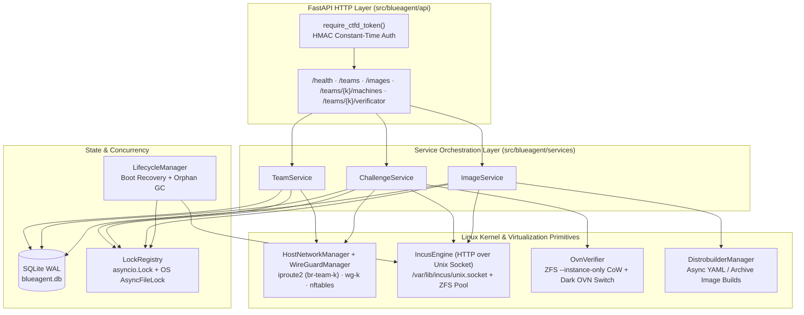
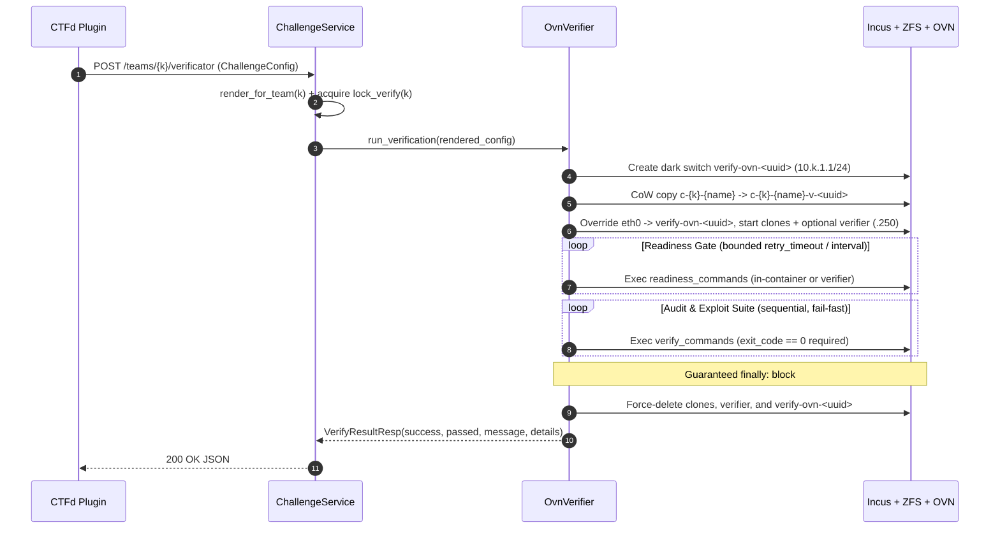

# BlueAgent — Bare-Metal Cyber-Defense Control Plane

[](https://www.python.org/)
[](https://fastapi.tiangolo.com/)
[](https://linuxcontainers.org/incus/)

**BlueAgent** is an asynchronous, bare-metal orchestration daemon written in Python (FastAPI) for **Patch-and-Defense (Blue-Team) Capture The Flag** competitions and cyber ranges.

Unlike traditional jeopardy CTF spawners that instantiate static read-only containers behind TCP proxies, BlueAgent gives every team a dedicated, stateful Layer-2/Layer-3 network accessible over WireGuard so players can SSH into vulnerable services, analyze logs, apply live binary/source patches, and trigger **zero-downtime SLA & exploit verification** inside isolated **Dark OVN** Copy-on-Write sandboxes.

> Looking for full host bootstrap instructions or CTFd integration? See the [Root Monorepo README](../README.md) and [Contributor Guide](CONTRIBUTING.md).

---

## Table of Contents

1. [Core Architectural Pillars](#1-core-architectural-pillars)
2. [Verification Pipeline Lifecycle](#2-verification-pipeline-lifecycle)
3. [Project Structure & Layering](#3-project-structure--layering)
4. [REST API Reference](#4-rest-api-reference)
5. [Declarative Challenge Specification (`ChallengeConfig`)](#5-declarative-challenge-specification-challengeconfig)
6. [Configuration Reference (`BLUEAGENT_*`)](#6-configuration-reference-blueagent_)
7. [Developer Setup, Multi-Process Mode & Testing](#7-developer-setup-multi-process-mode--testing)

---

## 1. Core Architectural Pillars



### 1.1 Hybrid Network Split (Hot Path vs. Cold Verification Path)
- **Player Hot Path (Native Linux Kernel Primitives):** Every team `k` (`0..254`, with `1..254` used for CTFd teams and `0` reserved for host/infrastructure testing) gets a dedicated unmanaged Linux bridge (`br-team-{k}`, gateway `10.{k}.1.1/24`) and a kernel WireGuard interface (`wg-{k}`, gateway `10.{k}.0.1/24` on UDP port `51820 + k`). An `nftables` table (`inet blueagent`) enforces inter-team isolation, TCP MSS clamping (`maxseg size set rt mtu`), and egress NAT masquerading. Player traffic never traverses user-space proxies or OVS Geneve tunnels, guaranteeing near-zero latency during interactive SSH/GDB patching.
- **Verification Cold Path (Dark OVN Sandbox):** When a team triggers verification, BlueAgent creates a fresh, uniquely named Open Virtual Network logical switch (`verify-ovn-<uuid>`) backed by the `incusbr0` underlay. This sandbox is completely invisible ("dark") to WireGuard peers and other teams, preventing players from sniffing secret Proof-of-Concept (PoC) exploit payloads or spoofing SLA health responses.

### 1.2 Topological & IP Fidelity (`10.k.1.x/24`)
Inside `verify-ovn-<uuid>`, the virtual router gateway is configured with the **exact same IP (`10.{k}.1.1/24`)** as the live `br-team-{k}` bridge, and every cloned container retains its exact production IP (`10.{k}.1.{ip_suffix}`). Multi-tier applications (e.g., a web frontend talking to `10.k.1.11:5432`) work identically inside the verification sandbox without rewriting `/etc/hosts` or service configuration files.

### 1.3 Sub-Second ZFS Copy-on-Write Cloning
Team containers run on the `blueagent-zfs` storage pool and are named deterministically (`c-{team_k}-{spec.name}`). During verification, `OvnVerifier` clones each live target container via `incus copy c-{k}-{name} c-{k}-{name}-v-{uuid} --instance-only` (~100 ms metadata CoW operation), overrides `eth0` onto `verify-ovn-<uuid>`, and boots the clone while the live container continues serving the team uninterrupted.

### 1.4 Two-Tier Concurrency Control (`LockRegistry`)
`src/blueagent/locks.py` combines an in-process `asyncio.Lock` (preventing single-event-loop coroutine races) with a cross-process OS `filelock.AsyncFileLock` stored in `BLUEAGENT_LOCK_DIRECTORY` (`/tmp/blueagent_locks`), making BlueAgent safe under both single-worker and multi-worker (`uvicorn --workers N`) deployments:
- **`lock_team(team_k)`**: Guards mutating topology operations (team creation/deletion, VPN peer registration, container deployment/teardown).
- **`lock_verify(team_k)`**: Decoupled per-team verification lock (`timeout=0.1s` fail-fast → `HTTP 409 Conflict`). Because `lock_verify` is separate from `lock_team`, teammates can still register/download WireGuard configs while an OVN verification run is in progress.
- **`lock_global()`**: Serializes global `team_k` allocation when auto-assigning IDs.

### 1.5 Self-Healing Boot Reconciliation & Background Garbage Collection
- **Startup Reconciliation (`main.py` lifespan):** On daemon startup (e.g., after a host reboot), BlueAgent reads SQLite (`teams`, `members`, `running_containers`) and automatically recreates missing `br-team-{k}` bridges, `wg-{k}` interfaces, `nftables` rules, WireGuard peer entries, and restarts stopped challenge containers with their static `eth0` routes.
- **Background Orphan Sweeper (`LifecycleManager`):** Periodically scans Incus instances (`c-{k}-*-v-*`) and networks (`verify-ovn-*`). Any artifact older than `BLUEAGENT_RESOURCE_GRACE_PERIOD_SECONDS` (default `600s`) whose team lock is free is automatically force-deleted, preventing resource leaks after sudden power loss or `SIGKILL`.

### 1.6 Deadlock-Free Subprocess Execution (`CommandRunner`)
All host CLI invocations (`ip`, `wg`, `nft`, `distrobuilder`) route through `src/blueagent/network/_runner.py` using pure command builders in `src/blueagent/network/commands.py` (never `shell=True`). Standard output and error streams write directly to unlinked anonymous `tempfile.TemporaryFile()` descriptors rather than OS pipes, eliminating 64 KB pipe-buffer deadlocks if long-running child daemons inherit file descriptors, and avoiding `/proc/self/fd` `ENXIO` errors inside hardened chroots.

---

## 2. Verification Pipeline Lifecycle



> [!NOTE]
> **Verification Convention:** Every command in `verify_commands` must exit with **`0`** when the team has **successfully defended/patched** the service (and SLA remains intact), and non-zero if the service is still vulnerable or broken. For example, a PoC exploit script should return `exit 1` if it captures the flag/shell (patch failed) and `exit 0` if the exploit is blocked while valid requests succeed (patch passed).

---

## 3. Project Structure & Layering

```text
blueagent/
├── pyproject.toml                     # Hatchling build config, dependencies, pytest config
├── scripts/
│   └── host_setup.sh                  # Legacy Debian 13 lab setup + Team 0 demo script
├── src/blueagent/
│   ├── main.py                        # FastAPI app, lifespan boot recovery, router registration
│   ├── config.py                      # Pydantic Settings (BLUEAGENT_* env vars)
│   ├── dependencies.py                # FastAPI DI providers + constant-time Bearer/X-CTFd-Token auth
│   ├── models.py                      # Pydantic v2 schemas + {{...}} template renderer
│   ├── database.py                    # Async SQLite (aiosqlite WAL) persistence manager
│   ├── locks.py                       # Two-tier asyncio + OS filelock LockRegistry
│   ├── api/
│   │   ├── health.py                  # GET /health, GET /health/ready
│   │   ├── teams.py                   # Team & WireGuard member CRUD + live peer telemetry
│   │   ├── challenges.py              # Container deploy, selective teardown, OVN verificator
│   │   └── images.py                  # Async distrobuilder YAML / archive image endpoints
│   ├── services/
│   │   ├── teams.py                   # Team & member business logic + rollback orchestration
│   │   ├── challenges.py              # Deployment, readiness deferral, selective delete, verify
│   │   └── images.py                  # Image build lifecycle, SHA-256 caching, log streaming
│   ├── engine/
│   │   ├── base.py                    # Abstract ContainerEngine & NetworkEngine interfaces
│   │   ├── incus.py                   # Async httpx client over /var/lib/incus/unix.socket
│   │   └── network.py                 # Incus OVN logical network adapter
│   ├── incus/
│   │   └── devices.py                 # NIC & root disk device payload builders
│   ├── network/
│   │   ├── _runner.py                 # Async subprocess runner (anonymous tempfile I/O)
│   │   ├── commands.py                # Pure CLI vector builders (ip, wg, nft)
│   │   ├── addressing.py              # Deterministic 10.k.0.x / 10.k.1.x IP helpers
│   │   ├── host_net.py                # Linux bridge (br-team-k) & nftables manager
│   │   ├── wireguard.py               # Kernel wg-k keygen, peer management & telemetry parser
│   │   └── templates.py               # WireGuard .conf generator
│   ├── verifier/
│   │   └── ovn.py                     # Ephemeral Dark OVN CoW cloning & probe executor
│   ├── images/
│   │   └── distrobuilder.py           # Safe archive extraction, distrobuilder build & Incus import
│   └── lifecycle/
│       └── manager.py                 # Background orphan container/network garbage collector
└── tests/
    ├── test_*.py                      # 111 fast mocked unit & API contract tests
    ├── test_performance.py            # Provisioning & cloning latency benchmarks
    ├── test_thesis.py                 # Multi-team concurrency & thesis evaluation suite
    └── usability/                     # Live bare-metal Incus/WireGuard/OVN integration suite
```

---

## 4. REST API Reference

All endpoints except `/health` and `/health/ready` require authentication via either:
- `Authorization: Bearer <BLUEAGENT_CTFD_API_TOKEN>`
- `X-CTFd-Token: <BLUEAGENT_CTFD_API_TOKEN>`

Interactive OpenAPI / Swagger UI is automatically served at `http://<host>:8000/docs`.

| Category | Method | Endpoint | Auth | Success | Description |
| :--- | :---: | :--- | :---: | :---: | :--- |
| **Health** | `GET` | `/health` | No | `200` | Lightweight process liveness check (`{"status": "ok"}`). |
| **Health** | `GET` | `/health/ready` | No | `200` / `503` | Deep readiness check probing SQLite and Incus Unix socket. |
| **Teams** | `PUT` | `/teams/{team_k}` | Yes | `200` | Idempotent upsert of team `k` (`0..254`): provisions `br-team-k`, `wg-k`, and `nftables` rules. |
| **Teams** | `GET` | `/teams` | Yes | `200` | List all provisioned teams. |
| **Teams** | `GET` | `/teams/{team_k}` | Yes | `200` | Retrieve metadata for team `k` (`404` if absent). |
| **Teams** | `DELETE` | `/teams/{team_k}` | Yes | `204` | Tear down all team containers, peers, `wg-k`, `br-team-k`, and DB records. |
| **Members** | `PUT` | `/teams/{team_k}/members/{user_id}` | Yes | `200` | Idempotent registration of a WireGuard peer (`10.k.0.2..254`) for `user_id`; returns generated `.conf`. |
| **Members** | `GET` | `/teams/{team_k}/members` | Yes | `200` | List team members enriched with live kernel WireGuard `telemetry` (handshake, Rx/Tx, online state). |
| **Members** | `GET` | `/teams/{team_k}/members/{user_id}` | Yes | `200` | Fetch full WireGuard record (including `config_text`) for a member. |
| **Members** | `GET` | `/teams/{team_k}/members/{user_id}/config` | Yes | `200` | Download raw `text/plain` WireGuard `.conf` attachment. |
| **Members** | `DELETE` | `/teams/{team_k}/members/{user_id}` | Yes | `204` | Revoke peer key from kernel `wg-k` and remove member from SQLite. |
| **Challenges** | `POST` | `/teams/{team_k}/machines` | Yes | `201` | Deploy containers defined in `ChallengeConfig` onto `br-team-k` (skips `readiness_commands` for fast boot). |
| **Challenges** | `GET` | `/teams/{team_k}/machines` | Yes | `200` | List running containers for team `k` reconciled against live Incus state. |
| **Challenges** | `DELETE` | `/teams/{team_k}/machines` | Yes | `204` | Tear down containers: pass `?containers=web,db` for selective teardown, JSON `ChallengeConfig` body, or empty request to remove all team containers. |
| **Challenges** | `POST` | `/teams/{team_k}/verificator` | Yes | `200` | Execute zero-downtime ZFS CoW + Dark OVN verification; returns `VerifyResultResp` (`409` if already verifying). |
| **Images** | `PUT` | `/images/{alias}` | Yes | `202` | Start async `distrobuilder` image build from uploaded `.yaml` or `.tar.gz`/`.zip` context archive (cached by SHA-256 unless `?force=true`). |
| **Images** | `GET` | `/images` | Yes | `200` | List all registered images and build statuses (`building`, `ready`, `failed`). |
| **Images** | `GET` | `/images/{alias}` | Yes | `200` | Inspect status, fingerprint, and error details for an image alias. |
| **Images** | `GET` | `/images/{alias}/logs` | Yes | `200` | Fetch `text/plain` `distrobuilder` stdout/stderr log for debugging failed builds. |
| **Images** | `DELETE` | `/images/{alias}` | Yes | `204` | Delete image from Incus image store and SQLite (`409` if currently building). |

---

## 5. Declarative Challenge Specification (`ChallengeConfig`)

Both `POST /teams/{team_k}/machines` and `POST /teams/{team_k}/verificator` accept a `ChallengeConfig` JSON payload (the CTFd plugin authors specs in YAML or JSON and submits them here).

### Supported Dynamic Placeholders

BlueAgent natively interpolates placeholders via `ChallengeConfig.render_for_team(team_k)` across `containers`, `readiness_commands`, and `verify_commands`:
- `{{team_k}}` → Team integer index `k` (e.g., `3`)
- `{{subnet}}` → Team container subnet prefix `10.<team_k>.1` (e.g., `10.3.1`)
- `{{verifier_ip}}` → Ephemeral verifier container IP `10.<team_k>.1.<verifier.ip_suffix>` (defaults to `10.<team_k>.1.250`)
- `{{ip:<container_name>}}` → Resolved IP of a container declared in `containers` (e.g., `{{ip:vuln-web}}` → `10.3.1.10`)

### Example Specification

```yaml
challenge_id: pwn-notes-service
verify_internet_access: false

verifier:
  image: alpine-verifier
  ip_suffix: 250
  limits_cpu: "1"
  limits_memory: "256MB"

containers:
  - name: vuln-web
    image: notes-app-v1
    ip_suffix: 10
    limits_cpu: "1"
    limits_memory: "512MB"

readiness_commands:
  - target: container
    container_name: vuln-web
    cmd: ["sh", "-c", "nc -z 127.0.0.1 8080"]
    interval: 2
    retry_timeout: 30

verify_commands:
  # 1. SLA Check from external black-box verifier on the Dark OVN switch
  - target: verifier
    cmd: ["python3", "/opt/checks/check_sla.py", "--host", "{{ip:vuln-web}}", "--port", "8080"]
    timeout: 15
    retries: 2
    retry_delay: 1.0

  # 2. Exploit Check: exits 0 ONLY if the vulnerability has been patched
  - target: verifier
    cmd: ["python3", "/opt/checks/exploit_bof.py", "--target", "{{ip:vuln-web}}:8080"]
    timeout: 20
```

---

## 6. Configuration Reference (`BLUEAGENT_*`)

BlueAgent uses `pydantic-settings` (`src/blueagent/config.py`) and loads variables from the process environment or a local `blueagent/.env` file.

| Environment Variable | Type | Default | Description |
| :--- | :---: | :--- | :--- |
| `BLUEAGENT_HOST` | `str` | `"0.0.0.0"` | Bind address when running `python -m blueagent.main`. |
| `BLUEAGENT_PORT` | `int` | `8000` | HTTP listen port when running `python -m blueagent.main`. |
| `BLUEAGENT_DEBUG` | `bool` | `False` | Enables Uvicorn `--reload` when invoked via `python -m blueagent.main`. |
| `BLUEAGENT_LOG_LEVEL` | `str` | `"INFO"` | Logging verbosity (`DEBUG`, `INFO`, `WARNING`, `ERROR`). |
| `BLUEAGENT_CTFD_API_TOKEN` | `str` | `"secret-token"` | Shared secret token required on protected REST endpoints (**change in production**). |
| `BLUEAGENT_DATABASE_PATH` | `str` | `"blueagent.db"` | Path to the SQLite WAL state database. |
| `BLUEAGENT_INCUS_SOCKET_PATH` | `str` | `"/var/lib/incus/unix.socket"` | Filesystem path to the local Incus daemon Unix Domain Socket. |
| `BLUEAGENT_INCUS_API_VERSION` | `str` | `"1.0"` | Target Incus REST API version. |
| `BLUEAGENT_INCUS_BASE_URL` | `str` | `"http://localhost/1.0"` | Logical HTTP base URL used over the Unix socket transport. |
| `BLUEAGENT_INCUS_UPLINK_NETWORK` | `str` | `"incusbr0"` | Parent Incus bridge supplying OVN router uplink IPs. |
| `BLUEAGENT_INCUS_OPERATION_TIMEOUT` | `int` | `240` | Maximum seconds to wait for asynchronous Incus background operations. |
| `BLUEAGENT_LOCK_DIRECTORY` | `str` | `"/tmp/blueagent_locks"` | Directory storing cross-process `AsyncFileLock` `.lock` files. |
| `BLUEAGENT_DEFAULT_LOCK_TIMEOUT` | `float` | `30.0` | Default acquisition timeout (seconds) for team/global locks. |
| `BLUEAGENT_RECONCILIATION_INTERVAL_SECONDS` | `int` | `120` | Interval between `LifecycleManager` orphan sweep cycles. |
| `BLUEAGENT_RESOURCE_GRACE_PERIOD_SECONDS` | `int` | `600` | Minimum age (seconds) before an orphaned `-v-` clone or `verify-ovn-*` network is reaped. |
| `BLUEAGENT_WIREGUARD_CONFIG_DIR` | `str` | `"/etc/wireguard"` | Host directory storing generated WireGuard server/peer configs. |
| `BLUEAGENT_HOST_BRIDGE_PREFIX` | `str` | `"br-team-"` | Naming prefix for unmanaged Linux team bridges (`br-team-{k}`). |
| `BLUEAGENT_WG_INTERFACE_PREFIX` | `str` | `"wg-"` | Naming prefix for kernel WireGuard interfaces (`wg-{k}`). |
| `BLUEAGENT_WG_BASE_PORT` | `int` | `51820` | Base UDP port (`wg-{k}` listens on `51820 + k`). |
| `BLUEAGENT_WG_MTU` | `int` | `1420` | MTU configured on WireGuard interfaces and client `.conf` profiles. |
| `BLUEAGENT_WG_KEEPALIVE` | `int` | `25` | `PersistentKeepalive` interval (seconds) in generated client configs. |
| `BLUEAGENT_WG_PUBLIC_ENDPOINT` | `str` | `"127.0.0.1"` | Public IP or DNS hostname written to `Endpoint = <host>:<port>` in player `.conf` files. |
| `BLUEAGENT_NFT_TABLE` | `str` | `"blueagent"` | Name of the `inet` `nftables` table managed by BlueAgent. |
| `BLUEAGENT_IMAGE_BUILD_DIR` | `str` | `"/var/lib/blueagent/builds"` | Scratch directory for `distrobuilder` build contexts, rootfs output, and `build.log`. |
| `BLUEAGENT_IMAGE_BUILD_TIMEOUT` | `int` | `1800` | Maximum duration (seconds) for a single `distrobuilder` build job. |
| `BLUEAGENT_IMAGE_YAML_MAX_BYTES` | `int` | `262144` | Maximum upload size (256 KiB) for standalone `.yaml` image specs. |
| `BLUEAGENT_IMAGE_ARCHIVE_MAX_BYTES` | `int` | `104857600` | Maximum upload size (100 MiB) for `.tar.gz` / `.zip` image build contexts. |
| `BLUEAGENT_DISTROBUILDER_BIN` | `str` | `"distrobuilder"` | Executable name or full path for `distrobuilder`. |
| `BLUEAGENT_USE_SUDO_DISTROBUILDER` | `bool` | `True` | Prefix `distrobuilder` execution with `sudo -n` when BlueAgent is not UID 0. |
| `BLUEAGENT_READINESS_RETRY_INTERVAL` | `float` | `2.0` | Fallback polling interval (seconds) during container readiness checks. |

---

## 7. Developer Setup, Multi-Process Mode & Testing

### Local Virtual Environment Setup

```bash
cd blueagent
python3 -m venv .venv
.venv/bin/pip install --upgrade pip
.venv/bin/pip install -e ".[dev]"
```

### Running BlueAgent (Single vs. Multiple Worker Processes)

```bash
# Development mode (single worker + auto-reload; requires root on live host)
sudo env BLUEAGENT_CTFD_API_TOKEN="dev-token" \
         BLUEAGENT_WG_PUBLIC_ENDPOINT="172.20.10.2" \
         .venv/bin/uvicorn blueagent.main:app --host 0.0.0.0 --port 8000 --reload

# Production multi-process mode (e.g., 4 OS workers sharing SQLite WAL + /tmp/blueagent_locks)
sudo env BLUEAGENT_CTFD_API_TOKEN="prod-secret-token" \
         BLUEAGENT_WG_PUBLIC_ENDPOINT="172.20.10.2" \
         .venv/bin/uvicorn blueagent.main:app --host 0.0.0.0 --port 8000 --workers 4
```

### Running the Test Suites

1. **Fast Unit & API Contract Tests (No Root / No Incus Required — 111 Tests):**
   Mocks `ContainerEngine`, `CommandRunner`, and `NetworkEngine` against real temporary SQLite WAL databases and OS file locks:
   ```bash
   .venv/bin/pytest tests/test_*.py \
       --ignore=tests/test_performance.py \
       --ignore=tests/test_thesis.py -v
   ```

2. **Live Hardware Usability & Dataplane Suite (Requires Bootstrapped Debian 13 Host + `sudo`):**
   Exercises real `br-team-k` bridges, `wg-k` tunnels, `distrobuilder` image creation, container deployments, and Dark OVN verification:
   ```bash
   sudo .venv/bin/pytest tests/usability/ -v
   ```

3. **Performance & Multi-Team Concurrency Benchmarks (Live Host):**
   ```bash
   sudo .venv/bin/pytest tests/test_performance.py -v -s
   ```

---

## Contributing

Want to add a new endpoint, extend `ChallengeConfig`, or modify Incus/OVN orchestration? Read [`CONTRIBUTING.md`](CONTRIBUTING.md) for architectural invariants, mocking patterns, and pull request requirements.
