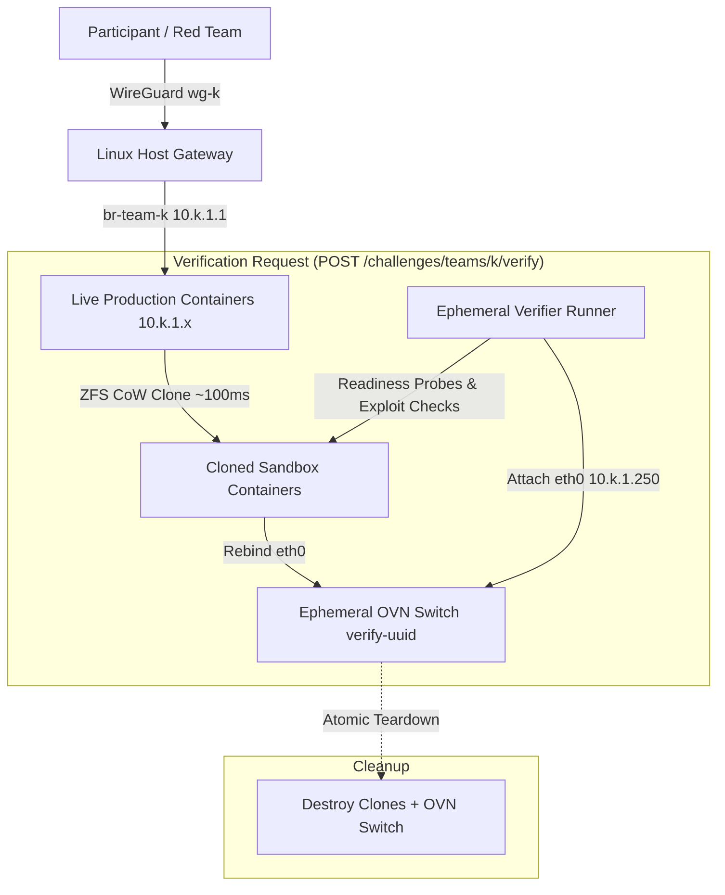

# BlueAgent v2

> Automated Blue-Teaming and Container Management Platform on Incus + OVN.

BlueAgent v2 provisions multi-container cyber-defense challenge environments with dedicated per-team WireGuard VPNs, deterministic L2 bridges, and dark SDN verification sandboxes powered by Open Virtual Network (OVN).

---

## Architecture Overview



---

## Features

- **Service Layer Architecture**: Decoupled domain business logic (`ChallengeService`, `ImageService`, `TeamService`) from FastAPI controllers for high testability and clean error handling.
- **Client-Agnostic Container Lifecycle & Native Templating**: BlueAgent manages containers running per team on dedicated bridges and natively resolves topology placeholders (`{{team_k}}`, `{{subnet}}`, `{{verifier_ip}}`, `{{ip:<name>}}`), allowing upstream clients (e.g. CTFd, CLI) to send abstract IaC configs.
- **Hybrid Network Design**: WireGuard L3 tunnels (`10.k.0.0/24`) + Linux Bridges (`10.k.1.0/24`) for near-bare-metal production performance; OVN SDN overlays for side-channel-free verification sandboxes.
- **Deferred Readiness & Deterministic Verification**: Readiness checks execute inside dark OVN clones before running verification checks (in-container audit via `incus exec` or black-box exploit testing from an ephemeral runner) with configurable retry policies on `CommandSpec`.
- **Parallel Lifecycle Operations**: Multi-container deployments, teardowns, and OVN sandbox CoW cloning execute concurrently via `asyncio.gather()`, cutting latency by 40–60%.
- **Reboot Kernel Reconciliation**: Lifespan startup routine automatically restores Linux kernel bridges (`br-team-k`), WireGuard interfaces (`wg-k`), peer configurations from SQLite, and restarts stopped challenge containers.
- **In-Memory Cryptographic IPC**: WireGuard keys and sensitive stdin buffers stream directly via async in-memory pipes without touching `/tmp` or persistent storage.
- **Incus Engine Optimization**: `exec_command` with `capture_output=False` reduces Incus HTTP roundtrips from 6 to 2 per network setup command.
- **Single Identifier (`team_k`)**: Teams and members are identified solely by team integer index `team_k` (range `0 <= team_k <= 254`).
- **Sub-Second CoW Snapshots**: Copy-on-Write container duplication on ZFS pools (~100 ms).
- **Concurrency & Race Prevention**: Per-team lock registry with verify-lock guards preventing race conditions during parallel deployments and verifications.
- **Self-Healing Lifecycle Manager**: Periodic background task cleaning up orphaned sandboxes older than configurable grace period (default 90s).

---

## Directory Layout

```
blueagent/
├── agent/                          # Modular architecture documentation
│   ├── context.md                  # Implementation tracking & context reference
│   └── blueagent_documentation/    # Token-optimized documentation modules
├── src/blueagent/
│   ├── config.py                   # Pydantic Settings
│   ├── models.py                   # Pydantic v2 schemas & domain models
│   ├── database.py                 # Async SQLite manager (aiosqlite)
│   ├── locks.py                    # Process & file-based lock registry
│   ├── dependencies.py             # FastAPI dependency injection providers
│   ├── main.py                     # FastAPI entrypoint & lifespan
│   ├── engine/
│   │   ├── base.py                 # ContainerEngine ABC & ExecResult
│   │   ├── incus.py                # IncusEngine UDS client
│   │   └── network.py              # Incus network helpers
│   ├── network/
│   │   ├── addressing.py           # Pure IP subnet calculator
│   │   ├── host_net.py             # HostNetworkManager (Bridges, routing, nftables)
│   │   ├── wireguard.py            # WireGuardManager (wg-k interface, peer configs)
│   │   └── _runner.py              # Subprocess execution wrapper
│   ├── images/
│   │   └── distrobuilder.py        # ImageBuilder background pipeline
│   ├── services/
│   │   ├── challenges.py           # ChallengeService (deploy, rollback, teardown, verify)
│   │   ├── images.py               # ImageService (YAML submission, build, catalog)
│   │   └── teams.py                # TeamService (bridges, WireGuard, member keys)
│   ├── verifier/
│   │   └── ovn.py                  # OVNVerifier async context manager
│   ├── lifecycle/
│   │   └── manager.py              # LifecycleManager orphan cleanup
│   └── api/
│       ├── health.py               # /health endpoint
│       ├── teams.py                # /teams endpoints
│       ├── challenges.py           # /challenges endpoints
│       └── images.py               # /images endpoints
├── tests/                          # Pytest test suite
└── pyproject.toml
```

---

## Quickstart

### 1. Prerequisites (Debian 13)

Run the host setup script to install Incus, OVS, OVN, ZFS, WireGuard, and nftables:

```bash
sudo ./scripts/host_setup.sh
```

### 2. Development Setup

```bash
uv venv .venv
source .venv/bin/activate
uv pip install -e ".[dev]"
```

### 3. Run Tests

```bash
pytest -v
```

### 4. Start the REST API

```bash
uvicorn blueagent.main:app --host 0.0.0.0 --port 8000
```

---

## REST API Reference

All protected endpoints require `Authorization: Bearer <token>` or `X-CTFd-Token: <token>`.

### Teams & WireGuard VPN (`/teams`)

| Method | Endpoint | Description |
|:-------|:---------|:------------|
| `POST` | `/teams` | Provision Linux bridge (`br-team-k`) and WireGuard interface (`wg-k`) for `team_k` |
| `GET` | `/teams` | List all provisioned teams |
| `GET` | `/teams/{team_k}` | Get team metadata and network parameters |
| `DELETE` | `/teams/{team_k}` | Teardown team containers, bridge, WireGuard interface, and database records |
| `POST` | `/teams/{team_k}/members` | Register member, allocate IP on `10.k.0.0/24`, generate Curve25519 keys & WireGuard client `.conf` |
| `GET` | `/teams/{team_k}/members` | List registered members (credentials masked) |
| `GET` | `/teams/{team_k}/members/{member_id}` | Retrieve member metadata |
| `GET` | `/teams/{team_k}/members/{member_id}/config` | Download raw WireGuard `.conf` configuration text |
| `DELETE` | `/teams/{team_k}/members/{member_id}` | Remove member from WireGuard peer list and free IP |
| `GET` | `/teams/{team_k}/peers` | Get real-time WireGuard peer telemetry (handshake, transfer bytes, online) |

### Containers & Verification (`/teams/{team_k}/machines` & `/teams/{team_k}/verificator`)

| Method | Endpoint | Description |
|:-------|:---------|:------------|
| `GET` | `/teams/{team_k}/machines` | List active running containers for team `team_k` |
| `POST` | `/teams/{team_k}/machines` | Deploy container topology to `br-team-k` with native templating, static IP injection, and atomic rollback |
| `DELETE` | `/teams/{team_k}/machines` | Teardown containers for team `team_k` (supports `?containers=web,db` query param, empty body, or legacy JSON payload) |
| `POST` | `/teams/{team_k}/verificator` | Execute deterministic dark OVN sandbox clone verification with readiness probes and native templating |

### Image Catalog (`/images`)

| Method | Endpoint | Description |
|:-------|:---------|:------------|
| `PUT` | `/images/{alias}` | Create or update Distrobuilder image specification or build context archive (`.tar.gz`/`.zip`) |
| `GET` | `/images` | List all registered images and build statuses (`building`, `ready`, `failed`) |
| `GET` | `/images/{alias}` | Retrieve status and metadata for a specific image alias |
| `GET` | `/images/{alias}/logs` | Retrieve real-time or completed build compilation logs (`text/plain`) |
| `DELETE` | `/images/{alias}` | Delete image alias and remove image from Incus (enforces active container foreign key check) |

---

## Configuration (`Settings`)

Configuration is managed via environment variables with the `BLUEAGENT_` prefix or a `.env` file:

| Variable | Default | Description |
|:---------|:--------|:------------|
| `BLUEAGENT_DATABASE_PATH` | `/var/lib/blueagent/blueagent.db` | Path to SQLite database file |
| `BLUEAGENT_CTFD_API_TOKEN` | `""` | Secret bearer token for CTFd authentication |
| `BLUEAGENT_INCUS_SOCKET` | `/var/lib/incus/unix.socket` | Path to Incus Unix Domain Socket |
| `BLUEAGENT_STORAGE_BACKEND` | `zfs` | Storage driver for CoW cloning |
| `BLUEAGENT_PARENT_NETWORK` | `incusbr0` | Parent bridge providing OVN uplink |
| `BLUEAGENT_GRACE_PERIOD_SECONDS` | `90` | Orphan cleanup grace period |
| `BLUEAGENT_LIFECYCLE_INTERVAL_SECONDS` | `60` | Background scan interval |
| `BLUEAGENT_UVICORN_WORKERS` | `1` | Number of worker processes |
| `BLUEAGENT_LOCK_DIR` | `/tmp/blueagent/locks` | Lockfile directory |
